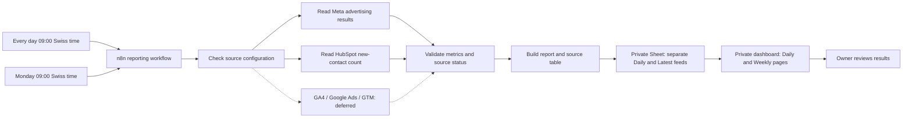

<h1 align="center">Advertising &amp; Reporting</h1>

A private daily and weekly reporting toolkit for advertising results and new-contact counts.

<strong>Verified metrics. Visible connection status. One private report.</strong>

Advertising & Reporting brings Meta advertising results and HubSpot new-contact counts into a private Google Sheet and Google Data Studio dashboard. One n8n workflow runs daily for yesterday's results and weekly for the previous seven complete days, validates the responses, and updates separate report tables.

The purpose is to make a personal marketing review easier: see what happened, understand which sources are connected, and distinguish measured inactivity from missing information.

> **Status — 16 October 2026: Partially complete and running.** Meta Ads and HubSpot reporting work, with private Google Sheets exports and separate Daily and Weekly dashboard pages. Both schedules passed manual and clock-triggered tests. **The originally planned full integration is unfinished:** GA4, Google Ads, and Google Tag Manager still require real project assets, approved access, configuration, and live verification. AI is disabled. This repository is a **public showcase of a private implementation**; source code, workflow exports, account data, and recovery material remain private.

## What it does

| Capability | What it gives the owner |
| --- | --- |
| **Daily reporting** | Every day at 09:00 Europe/Zurich, covering yesterday in the report timezone. |
| **Weekly reporting** | Every Monday at 09:00 Europe/Zurich, covering the previous seven complete days. |
| **Meta Ads results** | Available campaign spend, impressions, inline link clicks, and calculated ratios. |
| **HubSpot contact counts** | Contacts created during the reporting window, clearly labelled as contacts. |
| **Connection status** | A visible distinction between connected, unconfigured, inactive, partial, and failed sources. |
| **Private Google Sheet** | Separate Daily and Weekly overviews, with independent Daily and Latest data feeds. |
| **Private dashboard** | Daily and Weekly pages with source tables and HubSpot contact scorecards, restricted to the owner. |
| **Deterministic calculations** | Metric validation and arithmetic performed by reporting logic, with AI off. |
| **Access-expiry handling** | A report warning near Meta expiry and blocked collection after expiry. |

Provider collection is read-only. The workflow writes its report to Google Sheets; it does not change campaigns, budgets, CRM records, or outreach.

## How it works

Solid paths describe the accepted reporting configuration. Dotted paths describe deferred integrations and their visible setup status, with no provider collection enabled for them.

Reporting periods follow the verified Meta account timezone, recorded as **EET**. Both clock triggers follow **Europe/Zurich** separately. Both reports exclude the current, incomplete day. Daily and weekly executions write different ranges, including when both run on Monday morning. Read the [architecture](docs/ARCHITECTURE.md) and [data and metrics guide](docs/DATA-AND-METRICS.md) for the details.

## Connected now, deferred for later

| Source or destination | Verified configuration |
| --- | --- |
| Meta Ads | Connected and tested for reporting. Conversion action intentionally unset until a real goal is chosen. |
| HubSpot | Connected and tested with contact-read access. New contacts are not assumed to be leads or customers. |
| Google Sheets | Private owner-only report; Daily and Latest are overwritten independently. |
| Google Data Studio | Native Sheets connections for each feed; both dashboard pages and private access checked in the browser. |
| Google Analytics 4 | Deferred: no real website/app property is available yet. |
| Google Ads | Deferred: no real Google Ads customer ID is available yet. |
| Google Tag Manager | Deferred: no real website container is available yet. |
| AI summary | Disabled; no AI summary is part of the accepted reporting path. |

## Reporting principles

- **Zero needs evidence.** A successful empty advertising response can establish inactivity; an unavailable connection cannot.
- **Missing metrics stay blank.** Unconfigured conversions and unsupported metrics are not manufactured.
- **Contacts keep their meaning.** Contact creation is separate from lead qualification, sales, and revenue.
- **Ratios use totals.** CTR, CPC, and CPA are calculated from validated summed metrics, rather than averages of campaign percentages.
- **Incomplete data stays visible.** Detected advertising pagination is labelled partial; later pages are not collected yet.
- **Attribution stays separate.** Platform conversions, website key events, and CRM outcomes are not added together as equivalent results.

## Practical boundaries

Each feed stores **one reporting window**, with one header and five source rows. Daily exports overwrite `Daily!A1:M6`; weekly exports overwrite `Latest!A1:M6`. Daily runs preserve the weekly feed. Historical time series are not stored in either table. Data Studio can cache results, so its displayed refresh time may differ from the automation's execution time.

Meta access requires renewal. Warnings appear in the report within seven days of its recorded expiry; expired access blocks collection. There is no configured email or messaging alert. The self-hosted server and provider access must remain available for scheduled reporting to work.

This is a single-owner personal setup. Commercial copies, other marketing automation groups, automatic campaign optimisation, and customer outreach are outside the accepted scope.

## Explore the project

| Guide | Contents |
| --- | --- |
| [Capabilities](docs/CAPABILITIES.md) | Connected reporting, deferred source support, destinations, and action boundaries. |
| [Architecture](docs/ARCHITECTURE.md) | Scheduling, configuration checks, collection, validation, export, and dashboard separation. |
| [Data and metrics](docs/DATA-AND-METRICS.md) | Reporting windows, source statuses, metric definitions, formulas, and the 13-column feed. |
| [Privacy and reliability](docs/PRIVACY-AND-RELIABILITY.md) | Access scopes, private data, renewal, failure handling, and maintenance controls. |
| [Verification](docs/VERIFICATION.md) | Local tests, live checks, dated acceptance, and remaining evidence gaps. |
| [Roadmap](docs/ROADMAP.md) | Conditions for connecting real Google assets and possible future improvements. |
| [FAQ](docs/FAQ.md) | Availability, ownership, schedules, history, AI, and common questions. |

## Availability and feedback

This repository offers project information. It does not offer a public dashboard, runnable workflow, hosted reporting service, installation package, or download. The private implementation and report destinations are not accessible through this showcase.

Project questions and documentation corrections are welcome through [GitHub Issues](https://github.com/KSAGlory/Advertising-Reporting/issues). Read [SUPPORT.md](SUPPORT.md) before sharing information and [SECURITY.md](SECURITY.md) for private exposure reports.

## Author and Community

- Author: **KSAGlory**
- Community: [discord.gg/ksahub](https://discord.gg/ksahub)

## License

The implementation remains private and proprietary. No application, source-code, or workflow license is offered through this repository.

Referenced platforms, products, and third-party projects retain their respective rights and terms. This is an independent project and does not imply their endorsement.

Copyright © 2026 KSAGlory. All rights reserved.
